# RP2040 Macropad

A 9-key macropad with a rotary encoder and RGB lighting under every key, built around the RP2040.

I made it as an open project, so anyone can learn from it, change it or build one. The repo has the full KiCad project, the files to order it assembled at JLCPCB, and the notes behind the main design decisions.

  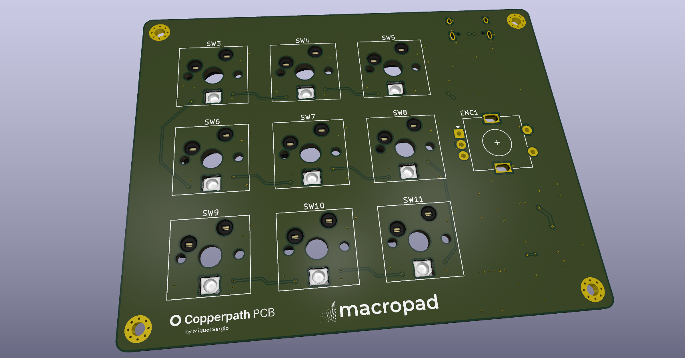
  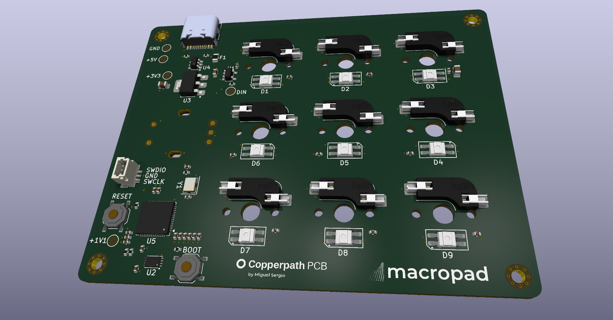

## Features

- RP2040 with 2 MB QSPI flash (W25Q16JV)
- 9 MX hot-swap keys (change switches without soldering)
- EC11 rotary encoder with push button
- One SK6812MINI-E RGB LED under every key
- USB-C (USB 2.0 Full Speed) with ESD protection and a 500 mA polyfuse
- BOOT and RESET buttons to load firmware over USB
- SWD connector with the Raspberry Pi Debug Probe pinout
- 2-layer board, 87 × 68 mm, every SMD part on the bottom side
- BOM and placement files with LCSC part numbers, ready for JLCPCB assembly

## Design notes

### RGB LEDs through a 74AHCT1G125 buffer

The SK6812MINI-E LEDs run at 5 V, and they need at least 0.7 × VDD (3.5 V) to read a logic 1. The RP2040 gives only 3.3 V. Driving them directly "works" on most boards, but it is out of spec, and it can fail with a different LED batch, a longer chain or a lower temperature.

The 74AHCT1G125 runs at 5 V and accepts 3.3 V logic at its input, so it turns the 3.3 V data line into a clean 5 V signal. A 330 Ω resistor in series protects the first LED input.

  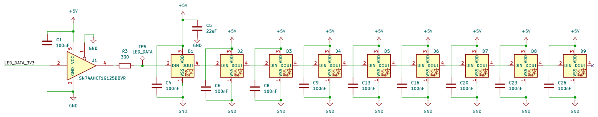

The LEDs are reverse mount: they sit on the bottom side and shine up through a cutout in the PCB, into the LED window of the switch. The chain goes in a zigzag (right to left, left to right, right to left) to keep the data line short.

### Every SMD part on one side

The hot-swap sockets and the reverse mount LEDs must be on the bottom side, so I put all the other SMD parts there too. JLCPCB assembles the board in a single pass, which is cheaper than two-sided assembly. The top side only has the switches (they click into the sockets, no soldering) and the encoder, which is the only part you solder by hand.

Both copper layers have a ground pour. The top one is almost unbroken, because most signals run on the bottom.

### USB-C input

- 5.1 kΩ resistors on CC1 and CC2, so any USB-C port or charger gives 5 V
- USBLC6-2SC6 ESD protection close to the connector
- 27 Ω series resistors on D+ and D- next to the RP2040
- 500 mA polyfuse on VBUS

  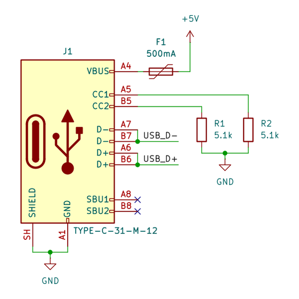
  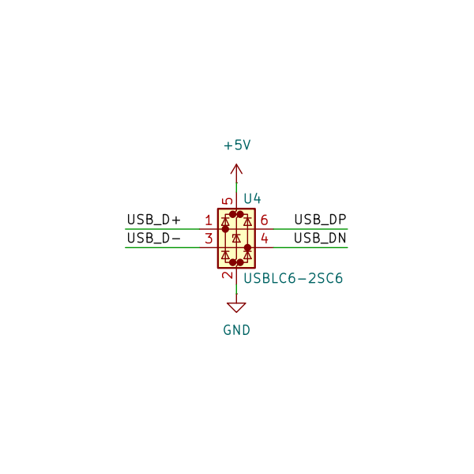

### Power

- AMS1117-3.3 LDO for the 3.3 V rail (a JLCPCB basic part, so no extra assembly fee)
- The RP2040 makes its 1.1 V core supply with its internal regulator
- The LEDs run from 5 V, with a 22 µF capacitor next to the first LED for the current peaks
- Keep the LED brightness limited in firmware, so the board stays inside the USB power budget

  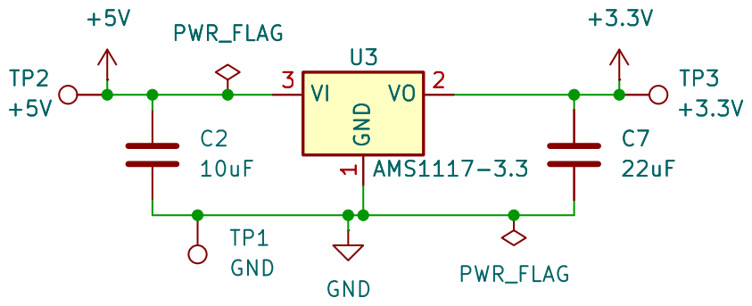

### Clock, flash and boot

- 12 MHz crystal (20 pF load) with 33 pF capacitors and a 1 kΩ resistor on XOUT, following the Raspberry Pi hardware design guide
- W25Q16JV flash in a small USON-8 package
- BOOT button on QSPI_SS (through 1 kΩ) and RESET button on RUN (with a 10 kΩ pull-up)

  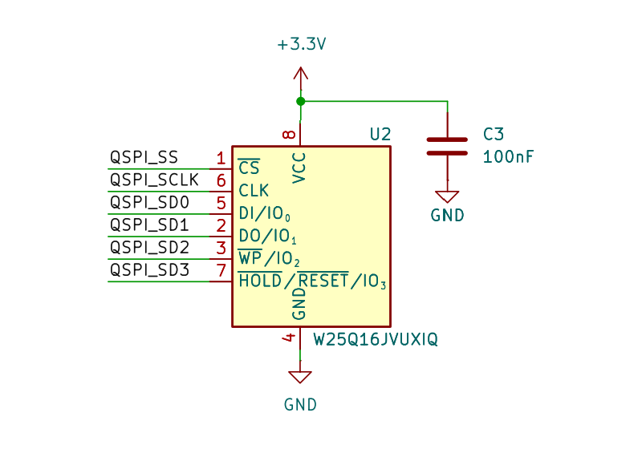
  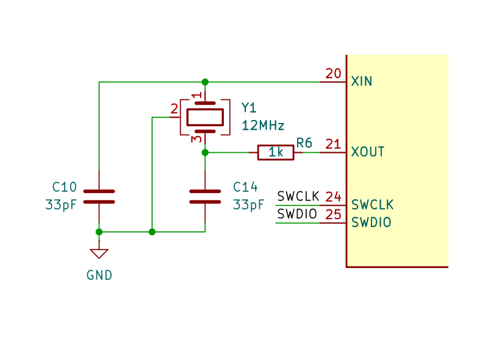
  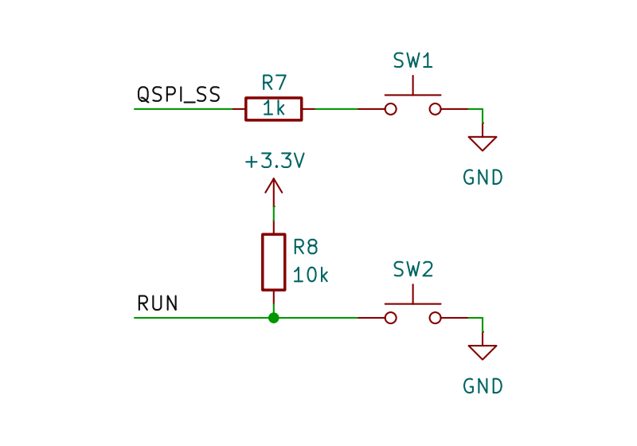

### Debug and test

- SWD on a 3-pin JST-SH connector (SWCLK, GND, SWDIO), the same as the Raspberry Pi Debug Probe cable
- Test points for GND, 5 V, 3.3 V, 1.1 V and the LED data line

### Mechanics

- Standard 19.05 mm key pitch, so any MX plate, keycap or case design fits
- Four M2 mounting holes, plated and connected to ground

## Pinout (for firmware)

| Function | RP2040 pin |
|---|---|
| KEY1 to KEY9 (SW3 to SW11) | GPIO0 to GPIO8 |
| Encoder signal A | GPIO9 |
| Encoder signal B | GPIO10 |
| Encoder push button | GPIO11 |
| LED data (through the 74AHCT1G125) | GPIO12 |
| SWD | SWCLK, SWDIO |

The encoder has two signals, A and B. Their order tells the firmware which way you turn the knob. Keys, the encoder and its button connect to ground, so use the internal pull-ups.

Key and LED position (top view). KEYx is the net name in the schematic, SWx and Dx are the reference designators on the board. D1 is the first LED in the chain, D9 the last.

| | Column 1 | Column 2 | Column 3 | Column 4 |
|---|---|---|---|---|
| **Row 1** | KEY1 (SW3) · D3 | KEY2 (SW4) · D2 | KEY3 (SW5) · D1 | USB-C |
| **Row 2** | KEY4 (SW6) · D4 | KEY5 (SW7) · D5 | KEY6 (SW8) · D6 | Encoder (ENC1) |
| **Row 3** | KEY7 (SW9) · D9 | KEY8 (SW10) · D8 | KEY9 (SW11) · D7 | |

SW1 and SW2 are the BOOT and RESET buttons, so the keys start at SW3.

## What is in this repo

| Path | Content |
|---|---|
| `macropad.kicad_pro`, `.kicad_sch`, `.kicad_pcb` | KiCad 10 project |
| `macropad.pdf` | Schematic in PDF |
| `macropad.kicad_dru` | Extra design rules for JLCPCB |
| `parts/` | Project library (hot-swap socket footprint and 3D models) |
| `production/` | Gerbers (`macropad.zip`), `bom.csv` and `positions.csv` for JLCPCB |
| `images/` | 3D renders |

## Ordering at JLCPCB

1. Upload `production/macropad.zip`. 2 layers, 1.6 mm, any color.
2. Turn on PCB Assembly and choose the **bottom** side.
3. Upload `production/bom.csv` and `production/positions.csv`.
4. Check the placement preview carefully: pin 1 of the RP2040, the LEDs, the USB-C connector, the SOT-23 parts and the hot-swap sockets (each one must sit over its two pads).
5. Solder the EC11 encoder by hand. It is not in the BOM.

## What else you need

- 9 MX switches (5-pin switches are best, they hold to the PCB without a plate)
- 9 MX keycaps and a knob for the encoder
- 4 M2 screws and standoffs, or a 3D printed case
- A USB-C cable with data lines (some cables only charge)

  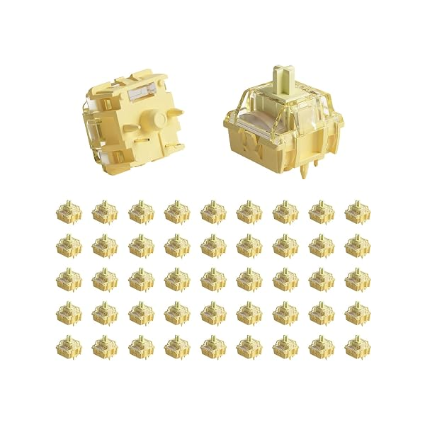
  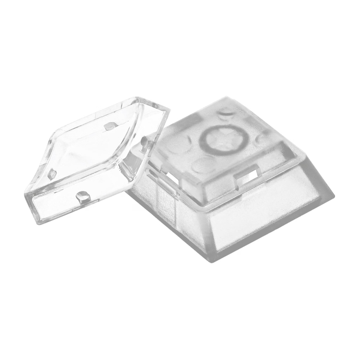
  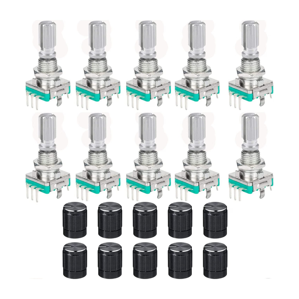
  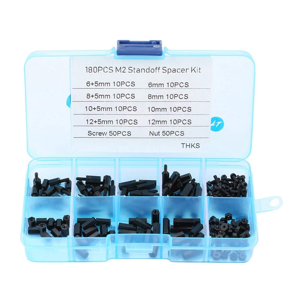
  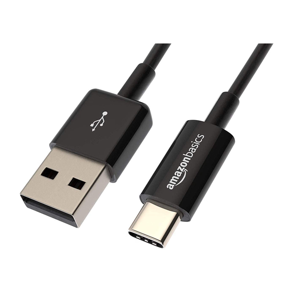

## Firmware

Firmware is not in this repo yet. The RP2040 is supported by QMK, KMK and the Pico SDK, and the pinout above is all you need. To load firmware, hold BOOT while you plug the USB cable (or press RESET), and the board shows up as a USB drive.

## License

This hardware is released under the [CERN Open Hardware Licence Version 2, Strongly Reciprocal](https://ohwr.org/cern_ohl_s_v2.txt) (CERN-OHL-S-2.0). See `LICENSE`.

## About

Designed by Miguel Sergio García ([Copperpath PCB](https://copperpathpcb.com)). I design and review PCBs for small companies and startups, mostly in KiCad and EasyEDA and ready for JLCPCB.

If you build one, change it or would do something different on this board, open an issue or tell me. I like to hear it.
